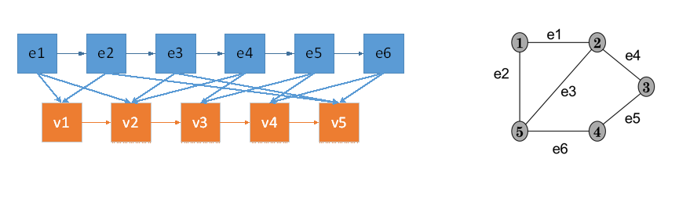
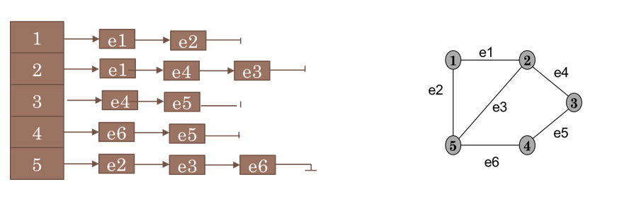
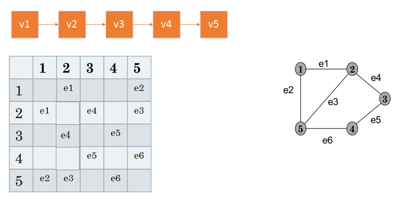
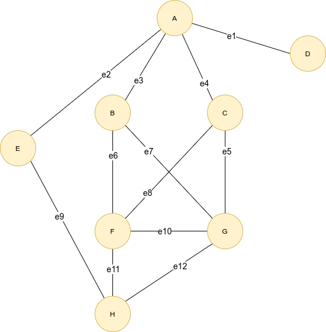

# ADT Graph — Parte 4 | Implementação de grafos

**Tópicos Avançados de POO — 2026/27 · Aula A3.4**

## Introdução — Três formas de representar um grafo

O mesmo ADT `Graph<V,E>` pode ser implementado com estruturas de dados diferentes. Neste projeto vão explorar três representações de um grafo não orientado.

### Lista de arestas — `GraphEdgeList`

Guarda uma coleção de vértices e uma coleção de arestas. Cada aresta conhece os dois vértices que liga. Para obter as arestas incidentes num vértice, é necessário percorrer a coleção de arestas.



### Lista de adjacências — `GraphAdjacencyList`

Guarda uma coleção de vértices e, em cada vértice, a lista das suas arestas incidentes. Uma aresta entre dois vértices distintos aparece nas listas de ambos. Esta organização facilita a consulta das ligações de cada vértice.


### Matriz de adjacências — `GraphMatrix`

Associa cada vértice a um índice de uma lista. A célula `matrix[i][j]` guarda a aresta entre os vértices desses índices, ou `null` se não existir ligação. Num grafo não orientado, a matriz é simétrica. Esta representação guarda apenas uma aresta por par de vértices.

## 1. Preparar e explorar o projeto

Utilizem **Java 17 ou superior e Maven**. Abram a pasta que contém `pom.xml` e localizem:

| Ficheiro | O que analisar ou completar |
| --- | --- |
| `Graph`, `Vertex` e `Edge` | Interfaces e Javadoc das operações |
| `GraphEdgeList`, `GraphAdjacencyList` e `GraphMatrix` | Atributos, classes internas e métodos com TODO |
| `InvalidVertexException` e `InvalidEdgeException` | Exceções para referências e operações inválidas |
| `Main` | Construção do grafo e consultas comuns às três implementações |

O `Main` está no package `tapoo`; os restantes ficheiros estão em `tapoo.graph`, dentro de `src/main/java`.

Podem utilizar **`Map`/`HashMap`, `List`/`ArrayList`, `Set`/`HashSet`, `Collection`, arrays e `Objects.equals`**. Utilizem o ADT fornecido neste projeto, sem acrescentar bibliotecas externas de grafos.

Estão fornecidos os construtores, as classes internas, os auxiliares de validação e pesquisa, as contagens, `vertices`, `edges`, `areAdjacent` e a sobrecarga de `insertEdge` que recebe elementos.

**Nesta aula devem completar três métodos em cada implementação: nove métodos no total.** Os restantes TODO ficam para consolidação.

### Executar

No IDE, executem `tapoo.Main`, indicando como argumento `edge`, `adjacency` ou `matrix`. Sem argumento, é utilizada a matriz.

N
O projeto inicial compila, mas apresenta `TODO CLASS: insertVertex`: ainda não consegue construir o grafo. Voltem a executá-lo após completar os três métodos da implementação escolhida.

## 2. Atividade 1 — Inserir vértices

Completem nas três implementações:

```java
Vertex<V> insertVertex(V vElement);
```

O método deve criar um vértice, guardá-lo e devolver a sua referência. Se já existir um vértice com o mesmo elemento, segundo `equals`, deve lançar `InvalidVertexException`.

1. Verifiquem se o elemento já existe; podem utilizar `findVertex`.
2. Criem uma instância de `MyVertex`.
3. Registem e devolvam o vértice criado.

| Implementação | Como guardar o vértice |
| --- | --- |
| Lista de arestas | Inserir no mapa de vértices, usando o elemento como chave |
| Lista de adjacências | Inserir no mapa; o novo vértice começa com uma lista de incidentes vazia |
| Matriz | Acrescentar à lista; a posição determina a linha e a coluna |

Na matriz, chamem `ensureCapacity()` antes de adicionar o vértice. A capacidade inicial de 20 pode crescer.

## 3. Atividade 2 — Inserir arestas

Completem nas três implementações:

```java
Edge<E, V> insertEdge(Vertex<V> u, Vertex<V> v, E edgeElement);
```

O método deve criar uma aresta entre dois vértices existentes e devolver a sua referência.

1. Validem os dois vértices com `checkVertex`.
2. Rejeitem um elemento de aresta já existente com `InvalidEdgeException`; podem utilizar `existsEdgeWith`.
3. Criem e guardem a aresta de acordo com a representação.

| Implementação | Como guardar a aresta |
| --- | --- |
| Lista de arestas | Criar `MyEdge(edgeElement, u, v)` e inserir no mapa de arestas |
| Lista de adjacências | Criar `MyEdge(edgeElement)` e adicionar a mesma referência às listas incidentes dos extremos |
| Matriz | Criar `MyEdge(edgeElement)` e guardar a mesma referência em `[i][j]` e `[j][i]` |


## 4. Atividade 3 — Obter as arestas incidentes

Completem nas três implementações:

```java
Collection<Edge<E, V>> incidentEdges(Vertex<V> v);
```

Validem o vértice e devolvam as suas arestas incidentes, sem repetições. Um vértice isolado deve originar uma coleção vazia.

| Implementação | Estratégia |
| --- | --- |
| Lista de arestas | Percorrer as arestas e selecionar as que têm `v` como extremo |
| Lista de adjacências | Copiar a lista de incidentes do vértice |
| Matriz | Percorrer a linha do vértice e recolher as células não nulas |

Devolvam uma **coleção independente**: alterar o resultado não deve modificar o grafo. Um lacete deve aparecer uma única vez.

## 5. Atividade 4 — Executar e comparar

Executem o mesmo `Main` com as três implementações e comparem com a ilustração:



| Consulta | Resultado esperado |
| --- | --- |
| Número de vértices / arestas | `8` / `12` |
| Conjunto de vértices | A, B, C, D, E, F, G, H |
| Conjunto de arestas | e1, e2, e3, e4, e5, e6, e7, e8, e9, e10, e11, e12 |
| A adjacente a C | `true` |
| F adjacente a E | `false` |
| Arestas incidentes em F | e6, e8, e10, e11 |

A ordem das coleções pode variar. Verifiquem também os seguintes casos em grafos pequenos:

| Caso | Resultado esperado |
| --- | --- |
| Vértice isolado | Sem arestas incidentes |
| Elemento de vértice repetido | `InvalidVertexException` |
| Elemento de aresta repetido | `InvalidEdgeException` |
| Referência de vértice `null` ou pertencente a outro grafo | `InvalidVertexException` |
| Lacete | Uma aresta e uma ocorrência na coleção de incidentes |
| Arestas paralelas com elementos distintos | Aceites nas listas; rejeitadas na matriz |
| Alterar uma coleção devolvida | O grafo mantém-se inalterado |
| Inserir mais de 20 vértices na matriz | A estrutura cresce e continua funcional |

Um elemento `null` é permitido; uma referência de vértice ou aresta `null` é inválida. Não alterem externamente elementos usados como chaves de mapas de forma a modificar `equals` ou `hashCode`.

## 6. Consolidação 

Acrescentem ao `Main`:

1. A consulta `opposite(g, e7)`, que deve devolver B.
2. A consulta `opposite(b, e9)`, que deve devolver `null`.
3. A remoção de F: devem ficar **7 vértices e 8 arestas**, sem e6, e8, e10 e e11.
4. A verificação de que referências removidas são rejeitadas, mesmo após uma nova inserção com o mesmo elemento. Tratem as exceções esperadas para permitir continuar a execução.

## Conclusão

As três representações permitem implementar o mesmo ADT, mas organizam a informação de forma diferente. Comparem o acesso às arestas incidentes, o espaço ocupado e a gestão de inserções e remoções.

Respondam: **que estrutura escolheriam para uma rede com muitos vértices e poucas ligações? Como adaptariam a matriz para suportar arestas paralelas?**

Na análise dos custos, incluam as validações: o acesso a uma célula é O(1), mas o `areAdjacent` fornecido pesquisa primeiro os índices com `checkVertex`, com custo O(n).

**Critérios de conclusão:**

- [ ] Os nove métodos da aula estão implementados.
- [ ] O mesmo `Main` produz os resultados esperados nas três representações.
- [ ] Foram verificados isolamento, duplicados, referências inválidas, lacetes e paralelas.
- [ ] As coleções devolvidas são independentes e a matriz cresce quando necessário.
- [ ] O estudante explica as diferenças entre as representações.
- [ ] Na consolidação, as restantes operações cumprem o Javadoc e mantêm a estrutura consistente.
